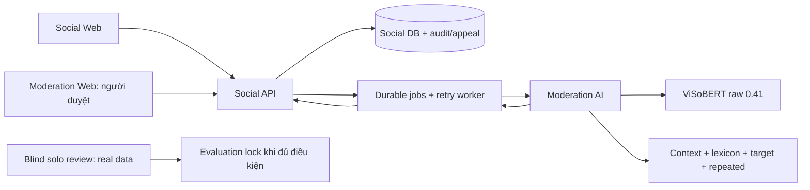

# FINAL_READINESS_REPORT

Ngày 03/11/2026 · ShieldVI · Stabilization & Evaluation Readiness

**Hoàn tất phần độc lập đủ điều kiện.** r06 và Context/Target/Repeated v5 đã khóa theo SHA. Không train r07, không đổi checkpoint/default/0.41, không deploy; dữ liệu thật hợp lệ và nhãn người vẫn0. Các kết quả dưới đây là synthetic development hoặc kiểm thử kỹ thuật, chưa phải independent real-world evaluation.

## DONE — có bằng chứng

- Audit hai event còn bỏ sót, không phát hiện lỗi kỹ thuật đủ căn cứ để sửa. Giữ nguyên4/6, precision1.0, recall0.667, evidence8/8. Không mở rộng rule để đạt6/6.
- Khóa 1311file: originalV1, defaultV1.1, r05/r06; context-v5/target-v5/repeated-v5; manifests, labels/splits, API contracts, code và test/evaluation/E2E artifacts. `READINESS_LOCK_T028_v2.json` không được ghi đè; verifier chỉ đọc và báo thay đổi, không tự reseal hay load model.
- T030 synthetic comparison/ablation/error analysis đã đóng băng; T032 phần kỹ thuật đã xác minh và lưu evidence. r06 không được chọn làm default chỉ từ synthetic metrics.
- Sửa một lỗi kỹ thuật T028 có test tái hiện: URL nguồn rỗng trước đây gâyAPI500 sau khi tạo pseudonym key; thêm min_length=1 để trả422 trước mọi ghi quarantine/key. Giữ nguyên seal gốc READINESS_LOCK.json; bản READINESS_LOCK_T028_v2.json có lineage, chỉ thay hash tooling/test và thêm proof. Model/rule/data/evaluation hashes giữ nguyên.
- 620AI/root testsPASS,0FAIL (1Starlette/httpx deprecation warning). Trong đó48test nhập/ẩn danh/provenance/solo review đã chạy riêngPASS. Chứng minh API chặn Round2 cũ khi Round1 thay revision, cho phép chính người đó xác nhận lại; không dùng người duyệt thứ hai.
- Browser Chrome kiểm UI review trên corpus tạm rỗngPASS: import bật, Round2 chọn được,0POST/0nhãn/0AIprediction/0externalrequest; process/corpus tạm đã dọn. Playwright Chromium không có sẵn, đã dùng Chrome được cài; không tải browser.
- Giữ và kiểm hash bằng chứng177Social testsPASS, browser5processE2EPASS và actual-model shadow/rollbackPASS từ lần trước; không báo là vừa chạy lại trong giai đoạn này.

## PARTIAL — chưa phải nghiệm thu toàn bộ task

| Task | Trạng thái hiện tại | Phần đã xong / phần còn thiếu |
|---|---|---|
| T028 | BLOCKED | Tool nhập/quarantine/ẩn danh/soloRound1–Round2 sẵn và đã test. Chưa có200thread có quyền nguồn/receipt, nhãn người và khóa độc lập. |
| T029 formal | BLOCKED | r06 experimental đã train trước đây; không train mới. Formal acceptance phụ thuộc T028, không có quyền train r07. |
| T030 | PARTIAL | Synthetic comparison/ablation/matrices đã frozen; chưa có independent real-world metrics. |
| T031 | PARTIAL | Local registry/shadow/fallback/rollback verified; không có quyền production activation và chưa đủ quality gate độc lập. |
| T032 | PARTIAL | Technical integration DONE_VERIFIED; full release acceptance còn dependency upstream. |
| T033 | PARTIAL | Handoff kiến trúc/dataset/training/comparison/limitations/demo đã có; kết luận ngoài thực tế và nghiệm thu cuối còn thiếu. |

Trạng thái DONE lịch sử trong task nguồn được giữ nguyên cho scope cũ; bảng này và `tasks/CURRENT_AI_SCOPE.json` là trạng thái hiện hành. Không đổi dependency để làm task PASS.

## Audit hai event còn bỏ sót

| Event | Bằng chứng | Kết luận ổn định |
|---|---|---|
| REP_FRESH_02 Khoa→Vy | Câu “cục chì cả đội phải kéo” không được bounded Context nhận; chỉ câu công kích tiếp theo đủ context+target | Giới hạn bao phủ ngôn ngữ; grouping không mất attack instance đã đủ điều kiện. Giữ miss, không thêm regex theo case. |
| REP_FRESH_11 Tien→Phuong | Hai attack cách3960giây=66phút; reciprocal root window đã khai báo là1800giây/16comment | Safety abstention đúng thiết kế; root không đủ target trong cửa sổ. Giữ miss, không tăng window sau khi xem challenge. |

Chi tiết context/target/instance/timestamp: [audit JSON](../../../reports/ai_update/stabilization_20261103/repeated_misses_audit.json). Không sửa reference, không inference lại challenge. Tập12scene do cùng AI viết sau khóa rule, không author-blind hay human gold; sau lần chấm đầu nó đã là dữ liệu đã xem.

## Kiến trúc được bàn giao



Social API sở hữu visibility/jobs/audit/appeal. AI trả raw score, context/lexicon, attack target, repeated evidence, policy risk và advisory riêng; không ghi Social DB hoặc tự ẩn. `reply_to_user_id` là người nhận reply, `directed_at_user_id` cần bằng chứng công kích. API nội bộ `/api/v1/moderate/comment` giữ contract1.0; `/api/v2/analyze` giữ analysis_version2.0. UI gán nhãn thật tách model, không hiển thị prediction.

## Dataset và training đã khóa

Canonical500thread/5115comment tái sử dụng, không sinh thêm trong giai đoạn này. Nhãn AI CLEAN4667/TOXIC369/UNCERTAIN79;102cờ cần review chưa phải human review. Derived split440train/30validation/30challenge; không sửa nguồn hoặc split. Pilot/reuse/source compiler và giới hạn tự nhiên đã ghi trong báo cáo r06. Challenge mới12thread/74comment (56CLEAN/18TOXIC) được giữ nguyên, không dùng training; không thay thế T028.

r06:4398synthetic-only binary rows(4085CLEAN/313TOXIC), originalV1 encoder frozen;592130classifier params được train;207steps/3epochs/79.75sCPU,4threads,chi phí ngoài0. AdamW LR1e-5, batch64, maxlen128, distillation0.25,T2, positive weight3.612633, seed20261103; chọn epoch3 trên synthetic validation. Không ViCTSD train trong r06, không full encoder fine-tune. ViCTSD test gốc không được dùng cho giai đoạn ổn định này. r05 là recipe mixed cũ, không ablation một biến so với r06.

r06 weights SHA256: `e5090150ab0d951887060a4cefd25c223fe7d11aa23dd174fedf8b4f18abe3b2`. OriginalV1/r05/default và các file threshold/tokenizer có hash trong lock; không ghi đè hay thay mặc định. Model hash xác nhận version, không chứng minh hiệu quả.

## T030 — metrics đóng băng

| Split | Model | Macro-F1 raw | Toxic P/R | TN/FP/FN/TP |
|---|---|---:|---:|---|
| synthetic_validation | V1 | 0.688581 | 0.3684/0.4667 | 279/12/8/7 |
| synthetic_validation | r05 | 0.670259 | 0.3529/0.4000 | 280/11/9/6 |
| synthetic_validation | r06 | 0.823834 | 0.6111/0.7333 | 284/7/4/11 |
| synthetic_challenge | V1 | 0.779884 | 0.5417/0.6500 | 280/11/7/13 |
| synthetic_challenge | r05 | 0.787645 | 0.5652/0.6500 | 281/10/7/13 |
| synthetic_challenge | r06 | 0.828798 | 0.6250/0.7500 | 282/9/5/15 |
| fresh_synthetic_challenge | V1 | 0.824506 | 0.8000/0.6667 | 53/3/6/12 |
| fresh_synthetic_challenge | r05 | 0.824506 | 0.8000/0.6667 | 53/3/6/12 |
| fresh_synthetic_challenge | r06 | 0.847265 | 0.8125/0.7222 | 53/3/5/13 |

Confusion matrix: hàng referenceCLEAN/TOXIC, cột predictedCLEAN/TOXIC. UNCERTAIN loại khỏi binary metrics với số lượng được báo; raw0.41 giữ nguyên. Accuracy/ToxicF1 và toàn bộ matrices/FP/FN/target/repeated nằm trong [evaluation.json đã khóa](../../../reports/ai_update/repeated_recovery_20261103/evaluation/evaluation.json). Không gọi các split này là independent real-world test.

| r06 old challenge ablation | Repeated TP/FP/FN | Advisory Macro-F1 |
|---|---:|---:|
| before | 0/0/5 | 0.887577 |
| context_only | 4/0/1 | 0.916156 |
| target_repeated_only | 1/0/4 | 0.887577 |
| after | 5/0/0 | 0.916156 |

Lexicon giữ cố định trong ablation, không đổi model/score/threshold. Bảng đầy đủ3model×3split×4variant đã frozen; không cherry-pick. Repeated cũ0/5→5/5,evidence10/10; mới2/6→4/6,P1/R.667,evidence8/8. Target mới14/16,P1/R.875. Trên890comment regression(886known), FP18→18/FN6→4, repeated2/10→8/10, evidence20/20, không thêm lỗi nhãn. r06 advisory challenge mới vẫnFP3/FN1; rawFP3/FN5. Hai repeated miss và các FN/FP còn lại không bị che.

File lỗi từng comment/pair: [error_analysis.json](../../../reports/ai_update/repeated_recovery_20261103/error_analysis.json). Số cũ trong prose34target/3event đã được sửa ở báo cáo v5: archived metrics có33/54target và2/10validated event; DANCE không có grounding reference nên không được cộng TP. Không sửa archived source labels.

## T032 — evidence kỹ thuật được giữ

177Social tests và browserE2E đã kiểm register/post/comment, moderation job, admin offline, review/hide, appeal/restore/audit, worker retry và recovery. E2E5process sử dụng fixtureAI, SQLite/accounts tạm:2retry attempts,1appeal đã giải quyết; owned processes exited, privacy logsPASS, không migrate DB thật. Actual r06/V1 kiểm riêng qua localregistry/ASGI200→503→200, fallbackV1, implicit candidate selection bị từ chối; intervention/apology không vào repeated evidence. Các proof này được hash-freeze, không ngầm biến fixtureAI thành inference model thật.

Evidence: [E2E metrics](../../../reports/ai_update/repeated_recovery_20261103/e2e/metrics.json), [cleanup](../../../reports/ai_update/repeated_recovery_20261103/e2e/cleanup.json), [shadow/rollback](../../../reports/ai_update/repeated_recovery_20261103/registry_smoke.json). API contracts trong `contracts/` và source liên quan được khóa; không sửa backend/frontend runtime giai đoạn này, không npm build/redeploy.

## T028 — khả năng và giới hạn của công cụ

| Khả năng | Bằng chứng / ranh giới |
|---|---|
| Nhập JSON nguồn | `templates/T028_MANUAL_INTAKE.example.json`, UI8010 hoặc `/api/manual-intake`; CSRF/loopback bảo vệ; không nhận nhãn AI có sẵn. |
| Ẩn danh | Stable pseudonym, che PII được nhận diện, giữ parent/unknown timestamp; không sinh timestamp/actor. Cần human privacy review vì regex không bao phủ mọi PII. |
| Provenance | URL/khai báo quyền/receipt SHA/schema/graph/leakage được kiểm; URL rỗng bị từ chối422 trước mọi ghi inbox/key. Khai báo giấy phép không phải bằng chứng đã được duyệt. |
| Manual inbox | Luôn PENDING_SOURCE_PRIVACY_REVIEW, không tính real/human gold/training. Chưa có bước tự động promote nguồn tùy ý sang review corpus. Cần receipt đã kiểm chứng và adapter hỗ trợ. |
| Nhãn người | Cùng reviewer_id, Round1 và Round2; không CLEAN mặc định, đổi nhãn có history/reason/revision; stale Round2 không khóa được. Không giả reviewer thứ hai/agreement. |
| Cohort hiện tại |0/200thread hợp lệ,0human labels,0manual inbox; WikimediaPAUSED. Bộ30thread/313comment cũNOT_FOUND theo audit trước, không tái tạo bằng synthetic. |

Các nhãn/receipts trong unit tests chỉ là fixture tạm đã ghi rõ, không nhập vào corpus thật hay metrics. Browser readiness không gửi nhãn nào. Chưa yêu cầu người dùng gán nhãn trong phiên này.

## Checklist nghiệm thu còn thiếu — làm sau phiên này

### T028: nguồn → nhập → người duyệt → khóa

- [ ] **Người cung cấp nguồn:** có200hội thoại thật với URL/revision/receipt và quyền sử dụng có thể kiểm chứng; không dùng synthetic hoặc dữ liệu đã phát triển rule/train làm independent cohort. Không cần tạo contact giả để chạy collector; collector vẫn paused.
- [ ] **Developer/operator:** kiểm nguồn/giấy phép/attribution, adapter và receipt SHA trước khi đưa từ quarantine vào `threads/`. Nguồn ngoài adapter hiện có cần triển khai/kiểm thử adapter riêng; upload JSON chưa hoàn tất bước này.
- [ ] **Developer/operator:** kiểm parent-child, timezone/timestamp gốc, actors, full text và anonymization; giữ unknown thay vì bịa. Ít nhất2known participants theo validator; ưu tiên10–30comment, báo ngoại lệ/độ phủ thay vì thêm lời thoại. Rà PII thủ công.
- [ ] **Developer/operator:** exact/near leakage audit với toàn bộ development/train/previously viewed challenges; cả12fresh scene hiện đã được loại khỏi independent pool. Lưu version/manifest/source/privacy/completeness checks cho từng thread.
- [ ] **Bạn — Round1:** mở UI thật, dùng một mã riêng như `solo_01`; đọc đầy đủ context, gán CLEAN/TOXIC/UNCERTAIN, category/target/evidence và lý do; bấm xác nhận. Không xem dự đoán model; không mặc định tục=TOXIC hoặc reply=attack.
- [ ] **Bạn — Round2:** dùng đúng mã đó, rà lại sau khoảng cách hợp lý nếu có thể. Ghi lý do đổi nhãn và xác nhận revisionRound1 hiện tại; giữ UNCERTAIN nếu thiếu bằng chứng. Nếu sửa Round1, phần Round2 cũ phải được xác nhận lại. Đây là intra-review, không phải hai annotator.
- [ ] **Bạn/operator:** xuất CSV/history để lưu; kiểm source/privacy/completeness cho mỗi thread. Khóa evaluation qua UI khi mọi comment hoàn tất Round2. Không sửa annotation/source sau lock; thay đổi phải tạo version mới.
- [ ] **Developer:** chạy validator, xác nhận `t028_real_acceptance_ready=true` ở ít nhất200thread; kiểm lock/thread/export/annotation hashes. Pilot nhỏ khóa được không đồng nghĩa T028 đạt200. Khóa plan đánh giá trước inference và không dùng cohort này để tune.

### T030–T033: phần nghiệm thu tiếp theo

- [ ] T030: chạy paired V1/r05/r06 và ablation đã khai báo trên human-gold cohort đã khóa; báo P/R/F1/confusion, UNCERTAIN/abstention, target/repeated/evidence correctness và mọi suy giảm. Không tái gọi synthetic metrics là real-world.
- [ ] T031: sau quality review độc lập, người có thẩm quyền quyết định promotion/rollback/rollout. Local shadowPASS không tự cấp quyền đổi default/deploy; hiện không cần thực hiện bước này.
- [ ] T032: đối chiếu contract/E2E và failure recovery trên release/config được nghiệm thu khi upstream đạt; chỉ thay hệ thống thật sau quyền rõ ràng. Giữ manual review/appeal/audit và offline retry.
- [ ] T033: bổ sung real-world metrics, coverage/solo-review/domain-shift limitations, nguồn dữ liệu có quyền và sign-off. Đánh dấu hoàn thành formal từng task chỉ khi đủ evidence/dependency. Không train r07 theo checklist này.

## Demo local không đổi model

Chạy từ root dự án, giữ terminal server mở và dùng tab browser riêng. Không gán MODEL_PATH sang r06. App sử dụng default đã được duyệt hiện có (V1.1 nếu không có override); r06 ở đây là artifact nghiên cứu đã khóa.

```powershell
$env:STORE_SUMMARIES = "0"
.\.venv\Scripts\python.exe -m uvicorn app.main:app --app-dir services/moderation-ai --host 127.0.0.1 --port 8000 --no-proxy-headers
```

Mở `http://127.0.0.1:8000/dashboard/` với static Dashboard đã có. Kiểm `/health`; không hiển thị score giả khi model chưa load. Nhập `datasets/synthetic_conversations/genz_v2/dashboard_threads/SGZ500_0218.json`, bấm **Phân tích hội thoại**. V2 phải ghi repeated-v5 và evidenceC01/C06 cùng actor→target; replyC02 giúp giải thích target nhưng không là attack evidence. Raw score khác nhau theo checkpoint; không hứa đúng raw label mọi câu.

Công cụ gán nhãn thật, chuẩn bị để dùng sau:

```powershell
.\.venv\Scripts\python.exe scripts/review_real_dataset.py --port 8010
```

Mở `http://127.0.0.1:8010/`. Nhập reviewer ID và bấm **Áp dụng mã** để bật thao tác; Round2 chỉ bật ở comment đã có Round1 của chính mã đó. Khi corpus hợp lệ còn0, chưa có comment để gán là đúng. File nhập ở manual inbox chưa tự hiện thành corpus hợp lệ. Không cần nhập hay gán nhãn ngay. Không dừng process khác nếu port đã có người dùng; giữ nguyên model/default đang chạy.

Kiểm tra bundle trước demo:

```powershell
.\.venv\Scripts\python.exe scripts/verify_ai_readiness_lock.py --lock reports/ai_update/stabilization_20261103/READINESS_LOCK_T028_v2.json
```

VerifierPASS chỉ xác nhận version/hash/scope; không chạy model, không approve release. Nếu file đã đổi, báoFAIL và tạo version mới có review phù hợp, không tự cập nhật SHA để che thay đổi.

## BLOCKED và kết luận bàn giao

Cần dữ liệu thật có quyền, cùng một người hoàn tất hai lượt và lock độc lập để nghiệm thu T028; formal T029 và phần independent của T030–T033 vẫn bị chặn. Thí nghiệm r06 đã hoàn tất không bị chạy lại; hai miss được giữ như giới hạn. Không có dataset download, tài khoản/email giả, paid API, GPU train, model promotion, auto-hide, git push hay deploy trong phiên này.

Model/rule/data/evidence lock: [READINESS_LOCK_T028_v2.json](../../../reports/ai_update/stabilization_20261103/READINESS_LOCK_T028_v2.json). Latest tests/report gắn bằng [READINESS_ATTESTATION.json](../../../reports/ai_update/stabilization_20261103/READINESS_ATTESTATION.json), không reseal version lock. [README và lệnh kiểm chứng](../../../reports/ai_update/stabilization_20261103/README.md). File/status hiện hành: `tasks/CURRENT_AI_SCOPE.json`, `tasks/AUTO_PROGRESS.md`, `tasks/moderation-ai/TASK_ORDER_AI.md`.
