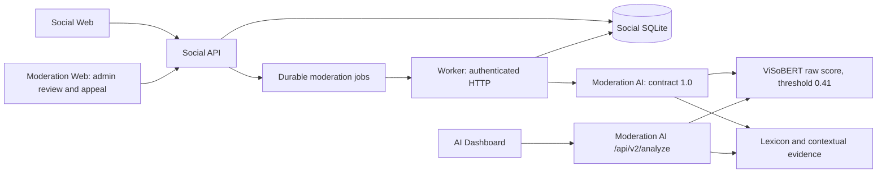

# ShieldVI technical report — current evidence

## 1. Problem

ShieldVI assists Vietnamese social moderation while keeping model prediction, contextual signals and human visibility decisions separate. The poster example motivated false-positive/false-negative investigation; it does not establish performance. This session generated research augmentation and measured remaining failures without changing baseline behavior.

## 2. System architecture

## 3. Repository and modules

Canonical root is ShieldVI_V3_Hybrid_Review. `services/moderation-ai/app` is the implementation; root `app` is an import bridge. Social API owns its DB/jobs/audit; AI never writes Social DB. This session added GenZ schema/compiler validation, versioned preparation, a protocol-specific research gate, a frozen development evaluator, isolated registry and E2E wrapper. No existing Social task status or production model selector changed. Previous document/AI-update directories remain backups.

## 4. AI API

`GET /health`, legacy `POST /api/analyze`, versioned `POST /api/v2/analyze`, authenticated `POST /api/v1/moderate/comment`, summary/review APIs remain available. Internal Social contract1.0 is advisory. V2 carries context, target/repeated evidence, analysis_version2.0 and policy_executed=false. Legacy recipient fields retain their old meaning. Real V1 smoke showed legacy/v2 raw-score identity and isolated503→200 recovery.

## 5. Historical datasets

This run uses6942 retained ViCTSD training rows and the unchanged historical validation split for proposed training selection. Test text is read only for exclusion, not labels, optimization or scoring. ViHOS is not loaded, relabeled or merged into the run; label definitions must be reconciled before any future integration. Old30-thread sources remain NOT_FOUND in the existing audit; they were not reconstructed. Prior100-thread training and150-comment regression fixtures remain separate evidence, not fresh test data.

## 6. Dataset A: REAL / T028

Actual0 valid threads/200,0comments,0human labels. Collector was tried within the bounded budget and exited2 before content requests because no genuine Wikimedia operator contact was supplied. Metadata source eligibility is not conversation collection or thread-level rights clearance. No contact/source/timestamp/license was invented. Genuine source authorization, anonymization, real labeling and evaluation lock remain missing. T028 stays BLOCKED.

## 7. Dataset B: synthetic

500threads/5115comments; 200 legacy threads/2048comments reused with unchanged text and lineage SHA,300new threads/3067comments authored directly by Codex. All timestamps/people are fictional. Output is `datasets/synthetic_conversations/genz_v2`, not the real directory or original200 snapshot. Eleven successful batch manifests:4 imported50-blocks, pilot20, next30, then five50-blocks.

15 broad domains with aliases cover game,fandom,social video,study,shopping,friendship,beauty,film/music,technology,sports,fanart/cosplay,travel,food,life,hobbies. Speaker counts3–6; comments10–18 observed (within requested10–30). 453/500 threads have10 comments; short threads dominate.

## 8. Generation method

Six explicitly authored catalogues contain300 new microplots and utterances. Python compiles the authored text; it does not create language by substitutions, model predictions or templates. It generates deterministic IDs/timestamps, performs schema/category adaptation and exports. No external LLM API or dataset download was used. Header plans name setting, voices, primary A–T scenario, semantic family and ending. Corpus checks run at every successful checkpoint. Checkpoint450 first rejected one duplicate sentence; the unpublished new sentence was rewritten and checked again, without relaxing the validator or altering earlier threads.

## 9. Labels and uncertainty

CLEAN4667,TOXIC369,UNCERTAIN79. All5115 are AI references, not human gold; new human confirmations=0. Fields retain source=synthetic, category, target/evidence, profanity/direct/repeated/apology/quote flags, reason and needs_human_review.102 comments carry uncertainty/review flags. Binary training excludes UNCERTAIN and flagged rows. Mixed apology+insult remains an attack; clean apologies, quotations, intervention and self-defense are not made toxic from keywords alone. Repeated annotations require prior same-actor/same-target attacks and distinct timestamps.

## 10. Quality and provenance

Technical checks PASS: timezone/increasing timestamps, IDs/users/parents/cycles, JSON schema, 3–6speakers/10–30comments, evidence consistency, exact comments, near comments, raw/delexicalized near threads, role-structure frequency and detailed-family split. Exact/near duplicates detected after corrections=0 at documented thresholds.396 distinct role sequences, maximum frequency12. Broad A–T patterns may still recur across splits: detailed family IDs plus character similarity cannot prove semantic separation or human-like variety. No independent naturalness review or agreement score exists. CLEAN dominates91.24%; this is not balanced training data.

## 11. ViSoBERT baseline

Original V1 is loaded from the existing local checkpoint, threshold0.41. The configured approved runtime default remains V1.1; the earlier synthetic experiment V2 is not the newly proposed candidate.31 protected hashes and original200 thread+2CSV checksums were verified unchanged. Original weights, tokenizers, thresholds, historical held-outs and root review SQLite were not rewritten.

## 12. Candidate fine-tune

PREPARED_NOT_TRAINED:11340 rows=6942ViCTSD+4398eligible synthetic,38.783%synthetic.440 train threads;60 newly authored development threads/620comments kept separate by detailed family. Preparation excludes exact/character5 near matches against validation,test text and development; observed exclusions0. Max fraction0.40 is a proposal, not an approved optimum. Proposed max3epochs,batch8×accumulation2,LR2e-5,maxlen128,seed20261103,patience1,3600seconds on approved ColabGPU. Local torch is CPU-only; matching GPU/cost receipt missing. Optimizer steps0; no new candidate/validation gain/reload result. Real gate remains unchanged for real protocols; G2-S recomputes synthetic eligibility instead of flipping a REAL manifest flag.

## 13. Hybrid context and lexicon

The current Hybrid annotates separate signals; it deliberately does not rewrite raw V1 toxicity. CLEAN review-flag rate is1/582 on this challenge; a review flag can be appropriate on a quotation, so this is not classifier FPR. Profanity detection2positive examples is too small and lexically coupled to AI flags to support generalization. No tuning followed evaluation.

## 14. Target detection

On35 AI-reference directed attacks, Hybrid emitted11targets, all11matched;24abstentions. Emission precision1.0 at coverage31.43%, not evidence of reliable full coverage. Parent/mentions can ground a candidate; they cannot alone prove attack intent. Legacy recipient IDs are not directly comparable target labels.

## 15. Repeated harassment

Seven reference actor-target events. Current legacy-API diagnostic:2TP,2FP,5FN (P=.50,R=.2857). HybridV2:0TP,0FP,7FN (recall0,precision undefined). No Hybrid evidence emitted; evidence correctness is undefined. This is a loss of recall on this synthetic challenge, not an improvement. No deployment/rule/model change was made in response.

## 16. Experimental results and ablations

V1 and Hybrid raw predictions are identical on617known labels;3UNCERTAIN excluded. Confusion rows[clean,toxic],columns[clean,toxic]:[[559,23],[15,20]]. MacroF1=.739974,accuracy=.938412; toxicP=.465116,R=.571429,F1=.512821; cleanP=.973868,R=.960481,F1=.967128. Paired classifier617ties,0wins/0losses by design. Frozen IDs/model/code hashes precede inference. The scoped T020 archive subsequently supplied original B0 captured responses for5unchanged regression fixtures/150comments. Original input/weight hashes match; engine.py is byte-identical, so B1 isolates new lexical behavior. B2 uses the original per-text lexical detection outputs with new context tags and retains old target/repeated behavior; B3 uses the full new signals. All149known script-tag projections keep identical raw predictions (1directed accusation leftUNCERTAIN), MacroF1=.827878. B0/B1/B2 each emit26evidence comments (7without directed-insult reference); B3 emits7, all7with directed-insult reference. These are tag-support counts, not target/event gold metrics. [Separate replay artifacts](../../../reports/ai_update/T030/regression_ablation/README.md) contain B0–B3 outputs and frozen hashes.

An original lexical module remains unavailable for unseen GenZ500 texts, so the replay is limited to the5captured inputs. The150 already-used regression examples are not merged into the60-thread challenge or counted as fresh test data. Candidate/B4 unavailable. No original test scoring or real blind evaluation. T030 is DONE for this declared development-evaluation deliverable; T028/REAL and T029/candidate remain BLOCKED. No overall improvement claim follows from lower evidence contamination on old fixtures, especially with repeated0/7 on the newer challenge.

## 17. Error analysis and system tests

[Error analysis](ERROR_ANALYSIS.md) lists all error artifacts and deterministic examples. Fullstack browser E2E uses explicit synthetic AI scores and a disposable SQLite: registration,post/comment,offline/retry,manual override,appeal,recovery PASS;5 server logs without private test markers,0direct browser-to-AI requests. Separate real V1 API/registry fallback smoke PASS. Social177tests PASS; threefrontend builds PASS. Root release suite and exact test commands/results are in ARTIFACTS and session verification. Fixtures are never represented as real model inference.

## 18. Limitations and release decision

REALgold0,human labels0,solo-independent agreement unavailable,synthetic label errors possible,short and explicit discourse overrepresented,semantic templates can recur,domain shift unmeasured. The model still mistakes defense/intervention and misses indirect attacks/threats. Candidate not trained. Do not promote V1/V2/localregistry or enable HIGH auto-hide from this run. T031 local tools are tested but activation/candidate comparison remains BLOCKED. T032 independently verifies the existing integration; this T033 deliverable is a bounded evidence handoff, not certification that all upstream tasks succeeded.

## 19. Future work

Provide legitimate REAL source/operator contact and rights; finish real anonymization/review/eval lock. Approve exact GPU/config/cost if candidate training is wanted. Preserve the frozen challenge: use separate development data to revise general context/target/repeated behavior, not lookup IDs or alter these labels. Recover verifiable pre-update snapshots for full ablation. Validate any candidate on historical validation, then immutable test and independent real data under the declared protocol; record regressions as well as gains before considering activation. No production deployment or live DB migration is authorized by this report.
