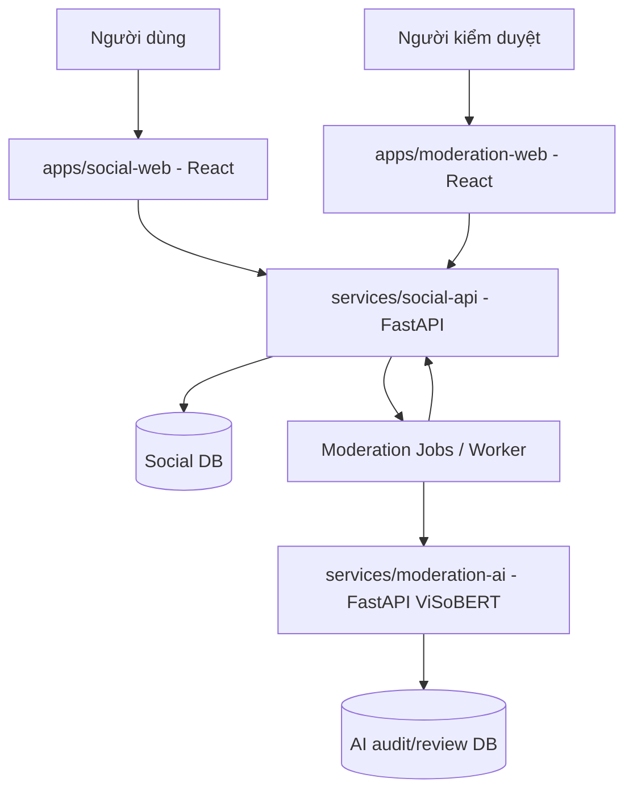

# Kiến trúc hệ thống ShieldVI Social AI

T015 đã chuyển canonical AI sang `services/moderation-ai/app`, React research V3 vào `apps/moderation-web/legacy-v3`, giữ URL `/dashboard/` và compatibility entrypoints tại root; [báo cáo migration](../archive/implementation_reports/T015_MIGRATION_REPORT.md). Dashboard Social `apps/moderation-web` và Social Web giữ source riêng. T014/T019 đã đo checkpoint CPU thật trên ViCTSD và E2E worker/review/appeal; T015 so sánh HTTP trước/sau với cùng model thật. Model/dataset/DB không di chuyển hoặc ghi đè, Social API vẫn sở hữu quyết định/DB. Shadow LOW publish/REVIEW flag, HIGH auto-hold tắt.

## 1. Mục tiêu
Một mạng xã hội tối thiểu có đăng ký/đăng nhập, đăng bài, bình luận, trả lời bình luận, bảng tin và kiểm duyệt AI. Một dashboard riêng cho admin duyệt cảnh báo, sửa nhãn, theo dõi khiếu nại.

## 2. Sơ đồ luồng

### Trách nhiệm
- **social-web**: UX người dùng, không truy cập trực tiếp model/AI DB, không cầm service API key.
- **social-api**: xác thực, phân quyền, quản lý post/comment, pagination, API cho web, workflow moderation và quyết định hiển thị.
- **moderation-ai**: nhận text và context đã lược thông tin, trả score/lexicon/target evidence; không tự ẩn/xóa nội dung hay khóa tài khoản.
- **moderation-web**: queue kiểm duyệt, review, nhật ký và kháng nghị; giao diện chỉ dành cho moderator/admin.

## 3. Luồng bình luận
1. Người dùng đăng bình luận vào `POST /api/v1/posts/{id}/comments`.
2. Social API xác thực, kiểm tra spam/rate limit, lưu nguyên bản với `visibility_status=PENDING_MODERATION`, `review_status=QUEUED`, `risk_tier=UNKNOWN`, ghi moderation_job trong **cùng transaction**.
3. Worker đọc job, gọi `POST /api/v1/moderate/comment` của AI qua mạng riêng, timeout/retry.
4. AI trả tín hiệu tư vấn; social-api áp dụng chính sách **minh bạch và có thể chỉnh**.
5. Theo [đặc tả T016](T016_POLICY_SPEC.md): LOW → PUBLISHED/NOT_REQUIRED; REVIEW → PUBLISHED_FLAGGED/QUEUED. HIGH shadow cũng PUBLISHED_FLAGGED, chưa bật auto-hold. Lỗi AI → UNKNOWN, giữ PENDING_MODERATION/QUEUED; job retry hoặc FAILED_PERMANENTLY + manual queue. **Không mặc nhiên coi lỗi AI là sạch**.
6. Moderator được quyền phê duyệt/ẩn với lý do. Người dùng có thể gửi appeal. Lưu review/audit.

Đối với prototype, có thể dùng một job worker đơn giản với table `moderation_jobs` và lệnh chạy riêng. Với tải lớn: Redis + Celery/RQ. Không nên dùng task nền trong cùng web process cho inference GPU cần đảm bảo retry/durability.

## 4. Chính sách AI
- ViSoBERT V1 vẫn là baseline; threshold `0.41` chỉ là threshold model hiện hành, KHÔNG tự động chuyển thành quy tắc xóa bài.
- Lexicon nhận diện từ nghi vấn, không kết luận toxic.
- Nhận diện bắt nạt lặp lại chỉ khi có thread context và nhiều evidence, không chỉ 1 bình luận.
- Cần lưu `model_version`, `lexicon_version`, threshold, timestamp, `request_id`, `evidence` cho truy nguyên.
- Không để hai service gọi chéo lặp vô hạn; AI API không gọi social-api.

## 5. Thiết kế vừa sức một người
Bắt đầu 2 backend + 2 frontend chạy trên máy dev, 1 social SQLite dev và 1 AI SQLite review riêng. Khi test xong mới nâng Social DB lên PostgreSQL và bổ sung queue Redis; không thêm Kubernetes/microservice orchestration phức tạp từ đầu.

## 6. Hạ tầng
- Cổng gợi ý: social-web `5173`, social-api `8001`, moderation-ai `8000`, moderation-web `5174` (cấu hình .env, không hardcode trong code).
- Dev: chạy từng server riêng, có thể dùng `docker compose` khi đã viết cấu hình.
- AI chạy Colab: **chỉ cho demo/dev**, không coi đây là endpoint production ổn định. Không đưa token/proxy Colab ra client.
- Triển khai công khai cần HTTPS, bảo mật tài khoản, backups, rate limit, giám sát và một máy chủ model ổn định.
