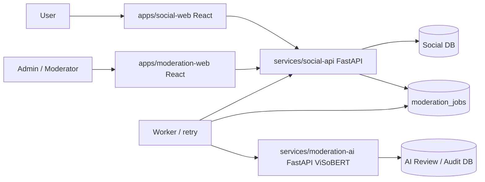

# 02 — Kiến trúc 2 backend + 2 web

## 1. Sơ đồ khối

## 2. Bốn ứng dụng
- `apps/social-web`: UI bài đăng, bình luận, tình trạng `đang kiểm tra`, báo cáo, kháng nghị; **không gọi AI API trực tiếp**.
- `apps/moderation-web`: UI cho moderator/admin, ưu tiên queue, audit và quyền rõ ràng; gọi Social API.
- `services/social-api`: quản lý người dùng, chính sách hiển thị, DB mạng xã hội, queue; **quyết định công khai nội dung**.
- `services/moderation-ai`: ViSoBERT V1 + lexicon + context/target rules; trả tín hiệu có version, không tự ẩn/khóa và không sửa Social DB.

## 3. Worker
- Khi user gửi comment, Social API lưu content+job **cùng transaction** rồi trả `201/202` nhanh.
- Worker poll job trong DB (MVP), lock/claim job chống chạy trùng; gọi AI API nội bộ, timeout, retry với exponential backoff; giới hạn attempts và dead-letter.
- Mỗi kết quả AI có `request_id`, `job_id`, `model_version`, `policy_version`; thao tác cập nhật idempotent.
- Nếu đã có quyết định người duyệt, job hoàn thành muộn **không được** ghi đè quyết định đó.
- Nếu lỗi AI, job đợi retry và nội dung mới mặc định chưa công khai (fail-closed về hiển thị trong MVP); có công cụ admin xử lý manual để không chờ vô hạn.

## 4. Môi trường
- Local: `social-web:5173`, `moderation-web:5174`, `social-api:8001`, `moderation-ai:8000` (chỉ minh họa, config bằng .env).
- DB: SQLite cho development và demo một máy; cân nhắc PostgreSQL trước nhiều người dùng/worker đồng thời.
- Các AI request dùng service auth nội bộ, không gửi client token, email hoặc password sang AI.
- Colab/Drive model dùng **demo/test**, không phải backend công khai luôn bật. Nếu muốn public cần GPU endpoint ổn định và giám sát.

## 5. Nguyên tắc phân quyền dữ liệu
Social DB sở hữu users, posts, comments, moderation decisions, report và appeal. AI DB chỉ chứa dự đoán/annotation/audit hạn chế; không đồng bộ toàn bộ PII. Dữ liệu truyền tối thiểu, ID opaque. Không có việc 2 backend cùng ghi trực tiếp vào một bảng.

## 6. Migration từ V3
Không di chuyển `app/`, `frontend/` ngay. Tạo Social API+Social Web trước, thêm AI adapter có kiểm thử hồi quy, sau đó mới chuyển code legacy nếu cần. Xem `docs/architecture/MIGRATION.md`.
