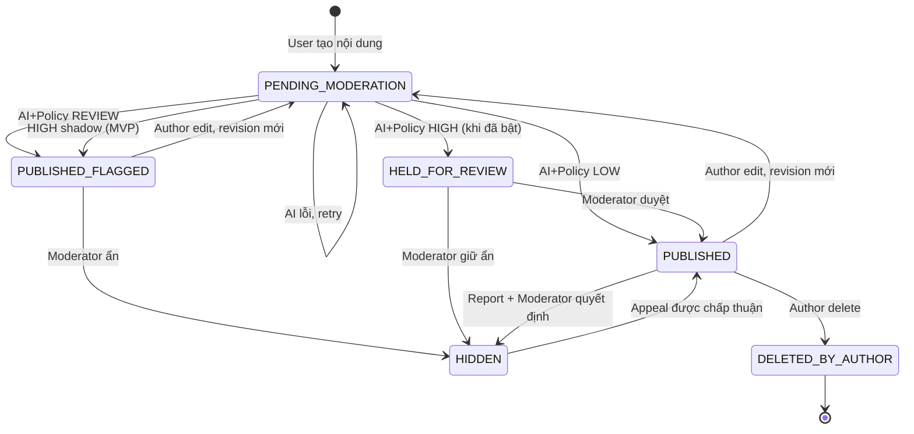

# 04 — Vòng đời bài viết/bình luận và state machine

Thiết kế chuẩn T016: [T016_POLICY_SPEC.md](../architecture/T016_POLICY_SPEC.md), mục 2/5/6/7. Runtime social đã có worker `social-policy-shadow-0.2` và manual review/appeal `manual-review-v1` ở T012/T017/T013/T018; [kiểm chứng T014/T019](../archive/implementation_reports/T014_T019_VALIDATION_REPORT.md). Enum uppercase dưới đây thay thế cách gộp status lowercase; không đổi DB/API legacy V3. HIGH auto-hold vẫn tắt.

## 1. Tách state
Không dùng một cột `status` để lẫn 4 ý nghĩa. MVP nên có:
- `visibility_status`: `PENDING_MODERATION`, `PUBLISHED`, `PUBLISHED_FLAGGED`, `HELD_FOR_REVIEW`, `HIDDEN`, `DELETED_BY_AUTHOR`.
- `review_status`: `NOT_REQUIRED`, `QUEUED`, `UNDER_REVIEW`, `APPROVED`, `REJECTED`, `APPEALED`, `RESOLVED`.
- `moderation_jobs.status`: `QUEUED`, `PROCESSING`, `SUCCEEDED`, `RETRY_WAIT`, `FAILED_PERMANENTLY`.
- `risk_tier`: `LOW`, `REVIEW`, `HIGH`, `UNKNOWN`.

## 2. Sơ đồ đơn giản

## 3. Luật không thể vi phạm
- `ai_label` không được đồng nhất `visibility_status`.
- Khi moderator đã ra quyết định, `decision_version` tăng và job kết quả cũ không có quyền ghi đè.
- `POST /moderation/decisions` kiểm tra role và chống thao tác hai admin đồng thời bằng optimistic concurrency.
- Ẩn nội dung không đồng nghĩa xóa vĩnh viễn; hard delete theo chính sách lưu trữ/xóa dữ liệu, không xóa audit vô hạn.
- Sửa nội dung đã đăng phải tạo `content_revision` và job mới; không dùng lại score cũ để phán xét text mới.
- Bài/bình luận có `parent_id` phải trỏ cùng bài; ngăn self-reference và cycle.
- Xử lý lỗi worker phải idempotent: cùng request id chạy lại không tạo hai quyết định/nhân đôi action.
- Approve/hide/restore chỉ moderator/admin, appeal chỉ author; report không tự đổi visibility. Bảng chuyển đầy đủ (kể cả edit/delete/appeal/claim/resolve) và source-state guards ở đặc tả T016 mục 5. DELETED_BY_AUTHOR là terminal cho API MVP.
- Guard worker kiểm tra request/job, content_revision, decision_version, policy snapshot, chưa bị xóa/chưa có quyết định người duyệt. Kết quả stale lưu outcome ignored, không đổi visibility.
- Edit từ mọi trạng thái chưa xóa đều đưa revision mới về pending; bản cũ không còn public. AI/manual approve bản cũ không được publish bản mới.

## 4. Khi AI không khả dụng
- Trả cho người viết response thành công với `visibility_status=PENDING_MODERATION` (không báo “đã công khai”).
- Retry có giới hạn, alert lỗi cho admin; manual review có thể giải quyết mà không cần GPU.
- Cần thời hạn xử lý & quy tắc hỗ trợ manual review phù hợp trước vận hành công khai. Không cam kết SLA chưa có nhân lực.

## 5. Ai thấy gì?
| Status | Tác giả | Người khác | Moderator |
|---|---|---|---|
| PENDING_MODERATION | Xem bản của mình + trạng thái chờ | Không | Thấy khi cần |
| PUBLISHED | Xem | Xem | Xem |
| PUBLISHED_FLAGGED | Xem + cảnh báo riêng nếu phù hợp | Xem | Thấy cờ theo dõi |
| HELD_FOR_REVIEW | Xem + trạng thái tạm giữ | Không | Xem + phê duyệt/ẩn |
| HIDDEN | Xem trạng thái và đường kháng nghị (nếu được phép) | Không | Xem nội dung + lịch sử |
| DELETED_BY_AUTHOR | Tombstone, không trả body qua API thường | Không | Metadata/audit theo quyền; không restore bằng API thường |

Quyền public còn phụ thuộc **mọi ancestor**: post/parent comment bị chặn thì descendants bị che mà không sửa state con. Khôi phục parent chỉ hiện lại descendants vốn public, không khôi phục child hidden/pending/deleted. Áp guard cho cả direct ID/feed/count, không chỉ UI; tác giả child không được đọc body ancestor ẩn của người khác.
