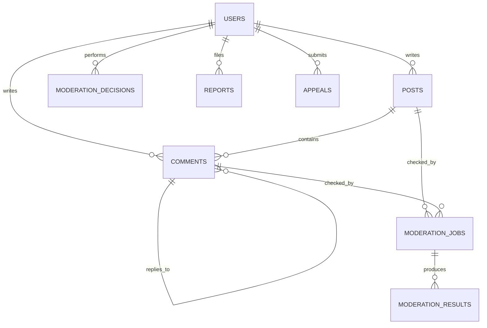

# 06 — Thiết kế dữ liệu (đề xuất, chưa migration)

## 1. Social DB là nguồn sự thật
| Bảng | Trường chính | Lưu ý |
|---|---|---|
| `users` | `id, username, email, password_hash, role, created_at` | Secret chỉ ở Social DB, `role` kiểm server-side |
| `posts` | `id, author_id, body, visibility_status, review_status, revision, created_at, updated_at` | Không hard delete khi chưa xử lý audit |
| `comments` | `id, post_id, parent_id, author_id, body, visibility_status, review_status, revision, created_at` | Validate parent cùng bài, không cycle |
| `moderation_jobs` | `id, entity_type, entity_id, revision, request_id, status, attempts, available_at, locked_until, last_error` | Claim atomically, unique `(entity,revision,type)` phù hợp |
| `moderation_results` | `id, job_id, model_version, model_threshold, ai_score, ai_label, risk_tier, policy_version, signals_json, created_at` | Không trộn AI label với quyết định hiển thị |
| `moderation_decisions` | `id, entity_type, entity_id, actor_id, action, reason, policy_version, content_revision, created_at` | Actor AI policy hoặc human; audit bất biến |
| `reports` | `id, reporter_id, entity_type, entity_id, reason, status, created_at` | Chống spam, chống lộ reporter |
| `appeals` | `id, author_id, decision_id, reason, status, resolved_by, resolved_at` | Liên kết quyết định cần kháng nghị |
| `content_revisions` | `id, entity_type, entity_id, revision, body_hash, created_at` | Phục vụ replay/trace; tránh lưu vô hạn nguyên văn |

Dữ liệu quan hệ dùng FK + index `post_id/created_at`, `(visibility_status,created_at)`, `(moderation_jobs.status,available_at)` và `moderation_decisions(entity_type,entity_id)`.

## 2. AI DB riêng
- ViSoBERT version, lexicon version, analysis trace, human review cho mục đích nghiên cứu đã được phép.
- Không lưu lại mật khẩu, email, IP nếu không cần thiết. Nếu lưu text phục vụ audit, hạn chế quyền, thời gian lưu và tính nhất quán với chính sách xóa dữ liệu.

## 3. Ghi dữ liệu nhất quán
- `posts/comments` và `moderation_jobs` được ghi **trong cùng transaction Social DB** để không tạo content thiếu job.
- Kết quả worker có `request_id` và `revision`: từ chối ghi dữ liệu cũ vào nội dung đã sửa.
- Thao tác quyết định có version để tránh stale write, luôn append audit record.
- Với SQLite local: WAL, connection per request, FK ON; worker đơn giản 1 instance. Công khai đa máy cân nhắc PostgreSQL.

## 4. Retention & export
- Không lưu bản gốc độc hại vô hạn mà không có mục đích; đặt retention cho log và snapshot.
- Người dùng có thể đề nghị xóa dữ liệu theo chính sách áp dụng. Admin audit chỉ lưu những trường tối thiểu cần cho tính giải trình.
- Backup database demo ngoài `/content` nếu dùng Colab, vì runtime Colab có thể bị xóa.

## 5. Sơ đồ quan hệ rút gọn

