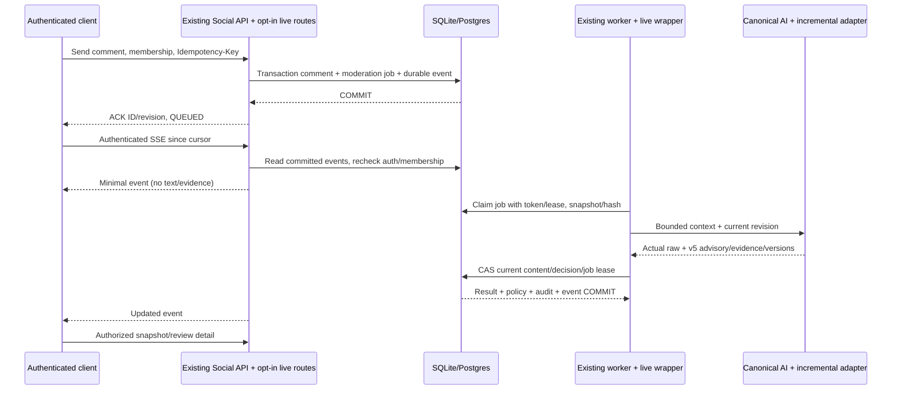

# Durable sequence and failure/recovery

POST retry keeps same key; changed body conflicts409. Worker crash recovers expired lease, old claim cannot finish. Edit/delete/manual decision invalidate old job/result; late result never restores tombstone or overrides moderator. AI timeout queues RETRYING with existing5/30second bounded backoff; exhausted FAILED remains pending/manual recovery, no invented labels.

SSE ID is durable monotonic integer. Client remembers cursor, orders by ID, ignores duplicate or older content/decision revisions. Reconnect revalidates token/active user/role/membership; expired/revoked access stops stream. Stream duration bounded25s, reconnect uses backoff; heartbeat does not keep a DB transaction open. Snapshot and cursor from same transaction, preventing snapshot/subscribe gap. Future retention/gap or invalid-ahead cursor requires fresh snapshot, not silent event loss.
